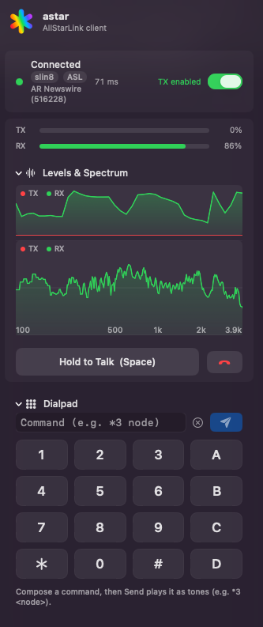

# astar

astar is a digital-voice client for **AllStarLink**, **EchoLink** and
**M17**. It connects over the network as a softclient — no radio, no hotspot,
no repeater in the path — and handles audio, push-to-talk, DTMF and level
metering itself.

**D-Star** and **System Fusion** are in the macOS app too — DExtra to XLX/XRF
reflectors, and YSF reflectors. System Fusion's vocoder runs on a USB dongle:
a **DVMEGA DVstick 30** or a **ThumbDV / DV3000**. D-Star uses the same
dongle by default, or a software vocoder built into the app that needs no
hardware at all.

Protocol, codec and audio handling live in one Rust engine; each platform gets a
native front-end over it rather than a shared web shell.

!!! info "Beta"

    astar is beta and moves quickly. AllStarLink is the primary target and takes
    the most testing. M17 needs nothing installed — Codec 2 is linked into the
    app as of `0.1.4beta`. D-Star and System Fusion work; System Fusion needs
    a hardware vocoder dongle attached, and D-Star needs either the dongle or
    the built-in software vocoder — see
    [Digital voice](macos/hardware.md#digital-voice).
    Other protocols are in the tree at various stages and are not claimed as
    working.

    The download is Developer ID-signed and notarized, so it opens without a
    Gatekeeper override. It is Apple Silicon only — a single `arm64` slice — and
    needs macOS 13 (Ventura) or later. On an Intel Mac,
    [build from source](build/index.md). There is no Homebrew tap, no cask, and
    no App Store listing.

[Download for macOS](https://github.com/rcludwick/astar/releases/latest){ .md-button .md-button--primary }
[Build it from source](build/index.md){ .md-button }
[:fontawesome-brands-discord: Discord](https://discord.gg/zDz5R8rVAM){ .md-button }

## Networks

| Network | Transport | Voice codec | Dials | Identifies as |
|---|---|---|---|---|
| AllStarLink | IAX2 (RFC 5456), UDP 4569 | µ-law / A-law / signed-linear (8 or 16 kHz), negotiated | Node numbers | Node number, via the allstarlink.org portal |
| M17 | UDP 17000 | Codec 2 3200 | Reflector + module | Callsign |
| EchoLink | UDP 5198 (audio) and 5199 (control) | GSM 06.10 | Callsign or node number | Validated callsign, logged in to the EchoLink directory |
| D-Star *(needs a dongle)* | DExtra, UDP 30001 | AMBE+2, on the dongle | XLX/XRF reflector + module | Callsign |
| System Fusion *(needs a dongle)* | YSF reflector protocol, UDP 42000 | AMBE+2 DN, on the dongle | YSF reflector | Callsign |
| NXDN *(needs a dongle; receive only)* | NXDNReflector, UDP 41400 | AMBE+2, on the dongle | Talkgroup on a reflector | Callsign + NXDN ID |
| DMR *(needs a dongle; receive only)* | MMDVM/homebrew repeater protocol, UDP 62031 | AMBE+2, on the dongle | Talkgroup + timeslot on one network's master | DMR radio ID (radioid.net) |

M17 transmits your callsign on the air; AllStarLink identifies by node number
instead, and authenticates against the portal rather than a per-node secret.

D-Star voice is AMBE, which runs on a hardware vocoder dongle by default.
Because D-Star's AMBE is out of patent, astar also has a built-in software
vocoder for D-Star alone, which you can choose in Settings → Vocoders instead
of a dongle. System Fusion, NXDN and DMR always need the dongle.
[Digital voice](macos/hardware.md#digital-voice) covers why, and what to buy.

## Beyond talking

A few things astar does besides carrying a conversation:

* **SSTV pictures.** When someone sends a slow-scan TV picture on an
  AllStarLink or EchoLink call, the macOS app decodes it, shows it as it
  comes in, and saves it, with a gallery of every picture received. astar
  only receives pictures; it never sends one. See
  [SSTV pictures](macos/sstv.md).
* **Recording.** The macOS app records a call at the press of a button, and
  [astar-server](server/recording.md) can record every transmission on a node.
* **Recording nets.** [`astar-netrec`](netrec.md), the net recorder, joins
  scheduled M17 and D-Star nets, listen-only, and keeps each one as audio, a
  log of who talked when, any SSTV pictures sent, and a video of the whole
  evening. It can also stream a public net live to YouTube and Twitch.
  [astar-server](server/nets.md) shows the recordings as a conversation in a
  browser.

## Where to start

-   __[The macOS app](macos/index.md)__

    A SwiftUI menu-bar client: an NSStatusItem that opens a dial popover, plus
    an optional Dock icon. macOS 13 or later.
    [Build it from source](build/macos-app.md).

-   __[astar-server](server/index.md)__

    The node daemon: answers AllStarLink calls, links nodes, bridges
    EchoLink and Discord, and serves a listener page and the net recordings.

-   __[The net recorder](netrec.md)__

    `astar-netrec` records scheduled nets, saves their SSTV pictures, draws
    each one as a video and can stream it live.

-   __[Building astar](build/index.md)__

    Toolchains, the Rust workspace, the Swift xcframeworks, `astar-server`,
    and the paused Iced client for Windows and Linux.

-   __astar-lib__

    The engine: IAX2 framing and session state, codecs, audio I/O, PTT
    backends, and the multi-network station facade. Pure Rust, no UI, exposed
    to Swift and Python through a C ABI.

-   __[Protocol notes](reference/index.md)__

    What was learned reverse-engineering `app_rpt`'s IAX2 link layer and the
    Web Transceiver call flow, cited to source, wire captures, or RFC 5456.

## Hardware

For push-to-talk, astar drives the generic class of USB radio interfaces —
serial PTT plus USB audio. The AllScan UCI150 (WCH CH343) is the reference
device, not a special case. Raw USB is the default transport and needs no
driver; the tty path is opt-in and on macOS needs WCH's driver. See
[Hardware](macos/hardware.md).

On macOS, the push-to-talk button on an **Inrico B02PTT** Bluetooth speaker-mic
keys astar too, with its mic and speaker as an ordinary Bluetooth headset. See
[Bluetooth PTT button](macos/bluetooth-ptt.md).

System Fusion, NXDN and DMR are hardware-only. Their codec, AMBE+2, is still
under patent and has no freely licensable software implementation, so it runs
on a dongle — a DVMEGA DVstick 30 or a ThumbDV / DV3000, either works. D-Star
uses the older AMBE, whose patent term has expired, so it can run either on
the same dongle or on the software vocoder built into the app. See
[Vocoders](macos/vocoders.md).

## Architecture

All protocol, audio and PTT logic lives in the Rust crates. The front-ends are
views over that engine, so a feature lands once and every client gets it, with
per-platform native UI.

## Platform support

| Platform | State |
|---|---|
| macOS 13+ | Supported. Menu-bar app; signed, notarized `arm64` [download](https://github.com/rcludwick/astar/releases/latest), or [build it](build/macos-app.md). Intel Macs build from source. |
| Windows / Linux | Paused. The engine is cross-platform and an [Iced](https://iced.rs) client (`apps/gui`) builds and runs on both, but it is unfinished and is not being tested or published; new features, SSTV pictures among them, are macOS-only for now. A replacement client that matches the macOS app is planned. [Building it](build/clients.md) is documented; using it is not. |
| Linux / macOS servers | `astar-server` and `astar-netrec` are built from source and run on both. See [astar-server](server/index.md) and [the net recorder](netrec.md). |
| iOS | Targeted. The Xcode project builds a multiplatform target; there is no shipping iOS client. |

The macOS app is the only published binary; everything else is built from
source. Day-to-day usage documentation is macOS-only for now.

## Community

[**astar on Discord**](https://discord.gg/zDz5R8rVAM) — where questions get
asked, bugs get reported before they are tickets, and on-air testing gets coordinated. astar is a
beta client for live amateur radio networks; hearing what broke on someone
else's setup is how it stops being broken on yours.

## Licence

**AGPL-3.0-only** for everything in the repository, except a few vendored
components that keep their own terms: the `ambe-thumbdv` ThumbDV driver
(MIT/Apache-2.0), Codec 2 and Bruce Perens' D-Star vocoder (LGPL), LAME for
the server's MP3 stream (LGPL), a fork of the `sstv` crate for SSTV pictures
(MIT), and the Inter typeface (SIL Open Font Licence). See
[Licence](about/license.md) for the full list.
