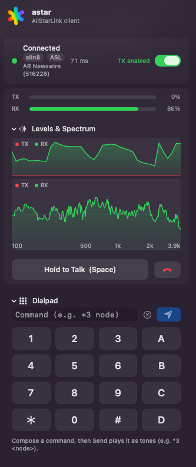

# The macOS app

astar on macOS is a **menu-bar app** that also, by default, shows up in the Dock
and in Cmd-Tab. After launch, look for the **rainbow asterisk** in the menu bar —
the product mark, a six-spoke asterisk, not a five-pointed star. Left-click opens
the dial popover; everything the client does happens there or in Settings.

To run it without a Dock icon, right-click the asterisk and turn off **Show in
Dock**. It takes effect immediately and persists across launches.

<figure markdown="span">
  { width="333" }
  <figcaption>Connected, receiving, with the spectrum and dialpad open.</figcaption>
</figure>

[Download astar.dmg](https://github.com/rcludwick/astar/releases/latest){ .md-button .md-button--primary }
[First run walkthrough](first-run.md){ .md-button }

!!! info "Requirements"

    macOS **13 (Ventura) or later**. The deployment target is set in
    `apps/macos/project.yml` and in AstarCore's `Package.swift`; the SwiftUI
    APIs the app uses that need it include `ViewThatFits`, in the status row.
    Building it also needs a full Xcode; see
    [Build it from source](../build/macos-app.md).

## What is in the popover

The popover is the whole client. In broad strokes:

* **Network picker** — AllStarLink, M17, EchoLink, and the digital-voice
  networks when their dongle is attached.
* **Dial field** — a node number, an address, a reflector or a callsign, plus
  [favorites and recents](favorites.md) from every network.
* **Connect / Disconnect**, with call state and round-trip time.
* **Push to talk** — press-and-hold in the UI, a hardware operator key on a USB
  radio interface, or VOX. Also a *TX disabled — listening only* mode when you
  want to monitor without any chance of keying.
* **Dialpad** for DTMF commands to the far end.
* **Quick settings** — input and output device, gains, VOX threshold and hang
  time, codec, talk timer.
* **Level meters and spectrum** for what you are sending and receiving.

Settings adds the rest: your AllStarLink and EchoLink accounts, saved configs ("setups"),
microphone profiles and characterization, serial PTT wiring, and device
selection.

## Finding your way around Settings

Open Settings with the sliders button in the popover footer, or with ⌘,
from the menu bar. It is one long list of sections: Operator, Account, EchoLink, DMR, NXDN,
Vocoders, Saved configs, Favorites, Mic Profiles, Reflector directory,
Spectrum, Recording and Backup.

That is a lot to scroll through, so each section folds away. Every section
header has a small triangle at its left edge, the same kind of disclosure
triangle as Quick settings and the Dialpad on the call screen. Click the
header, triangle or title, to open the section, and click it again to fold it
shut. A folded section shows only its header, so you can see every section's
name at once and open just the one you came for.

A few things make this quicker:

* **Expand All / Collapse All.** The button at the right of the Settings
  title opens every section at once. Once everything is open it turns into
  Collapse All, which folds them all again.
* **Option-click a triangle** to open or fold every section in one go, the
  way Finder's list view works. The section you clicked decides the
  direction: Option-clicking a folded one opens them all.
* **The "+" stays in the header.** Vocoders, Saved configs and Mic Profiles
  keep their "+" visible even while folded. Pressing it opens the section
  for you, so a new saved config appears in view, ready to be named.
* **Links into Settings open the right section.** Buttons elsewhere in
  astar that take you to one part of Settings, such as *Open Vocoder
  Settings…* after a refused D-Star connect or *Open EchoLink Settings…*
  when EchoLink has no login yet, open that section before scrolling to it.

astar remembers which sections you left open and which you folded, and
Settings comes back the same way the next time, even after a restart. The
first time you open it, only Operator and Account are open, so it fits on
about one screen. This is a choice about your own Mac's window, so it is not
part of an exported config: importing someone's `.astarconfig` never
rearranges your Settings.

With VoiceOver, each section header reads as a button with its name and
whether it is expanded or collapsed. With keyboard navigation turned on in
System Settings → Keyboard, Tab reaches each header and Space opens or folds
it.

The running version is shown in the popover footer, so you can always tell what
you are looking at.

## Networks

| Network | Notes |
|---|---|
| **AllStarLink (IAX2)** | The primary target. Dials nodes; speaks the `app_rpt` link-layer dialect on top of IAX2. |
| **M17** | Native support, including reflectors. Transmits your callsign, so set it before you key. The app links Codec 2 in, so there is nothing to install; a system `libcodec2` is used in preference when one is present — see [Codec 2](../build/prerequisites.md#codec-2-only-for-m17). |
| **EchoLink** | Log in with your validated callsign, browse and search the station list, call a station, talk and chat. Voice is GSM 06.10, built in. See [EchoLink](echolink.md). |
| **D-Star** *(needs a dongle)* | XLX/XRF reflectors over DExtra. Voice is AMBE, which runs on a **hardware vocoder dongle**, so the network appears in the picker only while one you have added in [Settings → Vocoders](vocoders.md) is attached — or always, when you choose D-Star's built-in software vocoder there. See [Digital voice](hardware.md#digital-voice). |

## Audio and PTT hardware

astar targets the generic class of USB radio interfaces — serial PTT plus USB
audio. The AllScan UCI150 is the reference device, not a special case. The
[Hardware](hardware.md) page covers the macOS driver situation and how the PTT
lines are wired.

## What these docs cover

Install and hardware setup, and a stub for day-to-day operating — see
[Using astar](usage.md). Detailed usage documentation has not been written yet.
