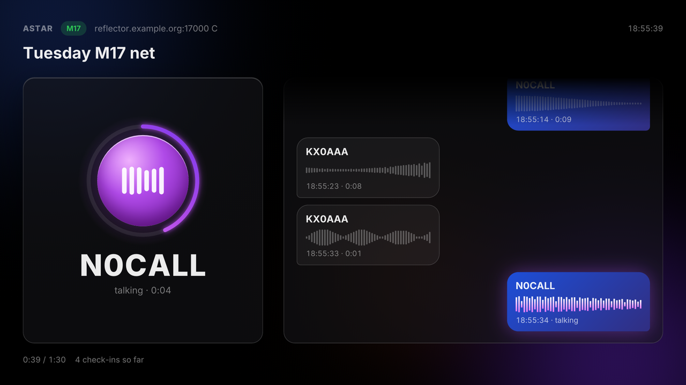

# Net recorder

A **net** is a scheduled on-air meeting: every Tuesday at 7 pm, say, a group
of operators gets on a reflector and takes turns checking in. If you cannot
be there, or you want a record of who said what, you need something that
listens at that time every week and keeps what it hears.

`astar-netrec` is that something. It is a small program that runs on a
Linux machine or a Mac and does one job. Shortly before each net you have
listed, it joins the net's reflector, saves the audio until the net is over,
and leaves. What it keeps is a folder per net and per night: one long audio
file of the whole evening, one small file for every **over** (an over is one
person's turn at the microphone, from the moment they key up to the moment
they let go), and a log of who talked when.

Two things can come out of that recording besides the audio. After each net
it can draw the whole evening as a **video**, `video.mp4`, ready to upload to
YouTube (see [Video of each net](#video-of-each-net)). And while a public net
is on the air it can **stream it live** to YouTube, Twitch or both (see
[Going live on YouTube](#going-live-on-youtube)). Both use `ffmpeg`, a free
program you install separately.

## It never transmits

`astar-netrec` is **receive-only**. It has no microphone, no sound device
and no push-to-talk line.

It is built on the same engine as the rest of astar, and that engine knows how
to key a radio, so the keying code is linked into the program. Three layers
keep the recorder away from it:

* **A wrapper with no keying call.** The recorder only ever holds a listener
  that can do three things: join a net, say how the link is doing, and leave.
  None of those keys a radio, and no other part of the recorder may hold the
  engine itself.
* **A check in CI.** `ci/guard-netrec-receive-only.sh` fails the build if the
  recorder's code names a keying call or reaches around the wrapper.
* **An audio backend with no microphone input.** Sound only comes out of the
  engine into the recorder. There is no input to send from, and D-Star's keying
  path refuses to run without one.

In practice that means:

* it never speaks on the reflector, not even to say who it is;
* it never opens a serial port for push-to-talk;
* a radio, a sound card and a USB radio interface can all be missing from
  the machine, and it works the same.

It does log in, because a reflector will not send audio to someone who has
not joined. It joins as your callsign plus a suffix letter, `<callsign> R` by
default, so the reflector's list of connected stations shows it as a separate
entry from you: `N0CALL R` next to `N0CALL`.

It also records other people's voices. Nets are open to the public, but it is
still worth knowing that the recordings sit on the disk named by `root` and
nowhere else, and that nothing leaves the machine.

## Networks it can record

This release records two networks:

| `network =` | Reflector kind |
|---|---|
| `"m17"` | M17 reflectors |
| `"dstar"` | D-Star reflectors that speak DExtra (XLX and the like) |

You name a reflector by its address: `host`, `port` and `module`. Looking
a reflector up by its name (`reflector = "M17-XYZ"`) comes later; for now
that key is refused on an M17 net, and on a D-Star net it is only a label.

AllStarLink and EchoLink are on the way (see [What is coming](#what-is-coming)).
A net with `network = "allstar"` or `"echolink"` is refused with "not yet
supported".

## Installing it

Build it with the release set, which includes the M17 codec and the
software D-Star vocoder:

```bash
cargo build --release -p astar-netrec --features release
```

That makes `target/release/astar-netrec`. Copy it somewhere on your `PATH`,
such as `/usr/local/bin/`. A build without `--features release` still runs,
but M17 then needs a system `libcodec2` at run time, and `check` and `run`
refuse a D-Star net on `[vocoder] dstar = "software"`.

### The first config

Ask it for a config. If the file does not exist, `run` and `check` write a
commented template there and read it back:

```bash
astar-netrec --config ./netrec.toml check
```

Open the file, fill in your callsign and at least one `[[net]]`, and run
`check` again. `check` reads the config, tells you anything that is wrong or
suspicious, and lists the next ten sessions it would record, with the time
it will join and the time it will leave. It makes no network connection.

### Running it as a service on Linux

[`astar-netrec.service`](netrec/astar-netrec.service) is a systemd unit. It
runs as an `astar` user, reads `/etc/astar/netrec.toml`, may write only to
`/var/lib/astar/netrec`, and restarts on failure after 30 seconds. The
comments at its top list the same commands as these. Run them from the folder
that holds the binary, the unit and the `netrec.toml` you filled in above:

```bash
sudo install -m 0755 astar-netrec /usr/local/bin/
sudo useradd --system --home /var/lib/astar astar
sudo install -d -o astar -g astar /var/lib/astar/netrec
sudo install -d /etc/astar
sudo install -m 0644 netrec.toml /etc/astar/netrec.toml
sudo install -m 0644 astar-netrec.service /etc/systemd/system/
sudo systemctl enable --now astar-netrec
```

Skip the `useradd` line if the machine already has an `astar` user.

The config has to be in place before the service starts. The service sees
`/etc` as read-only, so it cannot write the template there the way `check` does
in your own folder. Without a config it fails, and systemd tries again every 30
seconds until there is one. The same goes for `root`: leave it at
`/var/lib/astar/netrec`, because that is the only folder the service may write.

The 30-second wait is deliberate. A start that is refused (see
[One recorder at a time](#one-recorder-at-a-time)) would otherwise be retried
fast enough to hit systemd's limit on restarts and be given up on.

### Running it as a service on a Mac

[`org.astar.netrec.plist`](netrec/org.astar.netrec.plist) is a launchd agent.
Copy it to `~/Library/LaunchAgents/`, replace `YOU` with your user name
(launchd does not expand `~`), and load it:

```bash
launchctl bootstrap gui/$(id -u) ~/Library/LaunchAgents/org.astar.netrec.plist
```

It starts at login, restarts if it exits, and writes its log to
`~/Library/Logs/astar-netrec.log`. A Mac that is asleep records nothing; see
[Sleep](#when-the-machine-sleeps).

### ffmpeg for a service

Videos and live streams need `ffmpeg` (see [Installing
ffmpeg](#installing-ffmpeg)). On Linux, `apt install ffmpeg` puts it in
`/usr/bin`, which the systemd unit's `PATH` covers. On a Mac, the recorder
looks in Homebrew's folders itself, so a launchd agent finds `brew install
ffmpeg` without help. Anywhere else, set `[video] ffmpeg` to its full path.
Run `check` with the service's config to see which one it will use.

### Keys for a service

A service needs the [stream keys](#going-live-on-youtube) too, if any net
streams live, and there are two ways to give them.

**`credentials.toml` beside the config** works for both services, as long as
the file belongs to the user the service runs as and only that user can read
it. For the systemd unit that is `/etc/astar/credentials.toml`, owned by
`astar`:

```bash
sudo install -m 0600 -o astar -g astar credentials.toml /etc/astar/credentials.toml
```

For the launchd agent, it sits next to the `netrec.toml` named in the plist,
owned by you, with `chmod 600`.

**An environment file** is the other way on Linux. systemd reads it as root
before it starts the program, so the file can belong to root and be readable
by nobody else, not even the `astar` user. The unit already names one,
`/etc/astar/netrec.env`, and carries on without it when it is not there:

```bash
sudo install -m 0600 /dev/null /etc/astar/netrec.env
sudoedit /etc/astar/netrec.env
```

with lines like these (the values are placeholders):

```text
ASTAR_NETREC_YOUTUBE_STREAM_KEY=abcd-efgh-ijkl-mnop-qrst
ASTAR_NETREC_TWITCH_STREAM_KEY=live_000000000_ExampleExampleExample
```

then `sudo systemctl restart astar-netrec`. Never put a key in the unit file
or the plist themselves: anyone on the machine can read those.

## The commands

Every command takes `--config <file>`, which defaults to `./netrec.toml`.

| Command | What it does |
|---|---|
| `run` | Runs the recorder: waits for each net on the schedule, records it, and starts the next wait. This is what the service runs. |
| `check` | Validates the config and lists the next ten sessions. Before the list it says which `ffmpeg` it found (or why none) and which stream keys are set; see [What `check` prints](#what-check-prints). Writes the template if there is no file. |
| `now <NET> [--for 30m]` | Records the net called `NET` (any capitalisation) right now, for the length given, ignoring the schedule. Use it to try a new net. It streams live if the net says so, but it makes no video; run `render` on the folder afterwards. `Ctrl-C` ends it early and the file is kept. |
| `status` | Prints one line about the recorder using this config's `root`: `recording "Tuesday M17 net" since 19:00, linked`, `waiting for "Tuesday M17 net", joining Tue 2026-11-10 18:55`, `idle, nothing scheduled`, or `not running`. While a net streams live, the line ends with how each destination is doing; see [Both at once](#both-at-once). |
| `render <SESSION>` | Draws (or draws again) a finished session's `video.mp4`. `SESSION` is the session's folder, the one holding `session.json`. See [Rendering by hand](#rendering-by-hand). |
| `sstv <FILE> [--out <DIR>] [--codec <CODEC>] [--local <ADDR>]` | Decodes the SSTV pictures in a recording into PNG files. It reads no config and talks to no network. See [Decoding a recording by hand](#decoding-a-recording-by-hand). |

`status` and `now` need the config to exist already; they never write a
template, because a template's `root` would not be your real archive.

Logs go to standard error and follow `RUST_LOG` (the default is `info`).

### One recorder at a time

Two recorders logging in with one identity would each knock the other off
the reflector, so only one may run per `root`. The first to start takes an
operating-system lock on the file `root/.netrec.lock`; a second one refuses
with "another recorder is running".

That also means `now` cannot run while the service runs. To try a net by
hand, stop the service, run `now`, and start the service again.

The lock file is never deleted, and that is normal: the lock is held by the
running program, not by the file's existence, and the system releases it the
moment the program exits, even by a crash. Keep `root` on a local disk. The
lock may not work on NFS, SMB or a container bind mount.

## The config file

`netrec.toml` has six kinds of section: `[recorder]`, `[web]`, `[vocoder]`,
`[video]`, `[live]` and one `[[net]]` for each net. `[video]` and `[live]`
are optional and described under [Installing ffmpeg](#installing-ffmpeg) and
[Changing where streams go](#changing-where-streams-go). An unknown key is an error rather than
being ignored, so a typo shows up at once. Here is the template with every
default written out:

```toml
[recorder]
root = "/var/lib/astar/netrec"
callsign = "N0CALL"
callsign_suffix = "R"
my_callsigns = ["N0CALL"]
max_bytes = "50 GB"
max_age_days = 365
pre_roll = "5m"
post_roll = "10m"

[web]
local = false
bind = "127.0.0.1:8050"

[vocoder]
dstar = "dongle"
trusted_serials = []

[[net]]
name = "Tuesday M17 net"
network = "m17"
host = "m17.example.org"
port = 17000
module = "C"
when = "Tue 19:00"
duration = "90m"
tz = "America/Denver"
visibility = "private"
my_side = false
```

### `[recorder]`

| Key | Default | What it means |
|---|---|---|
| `root` | required | The folder the archive is kept in. The recorder creates it if it is missing. |
| `callsign` | required | The callsign it logs in with. The placeholder `N0CALL` works but draws a warning. |
| `callsign_suffix` | `"R"` | One uppercase letter or digit appended to the callsign for the login, so the reflector lists `N0CALL R`. Anything else is refused: a space would make the login read as your own callsign. |
| `my_callsigns` | `[]` | Callsigns that count as "my side" on the [recordings page](#the-recordings-page). Required if any net sets `my_side = true`. Each session records the list in its `session.json` when it starts, so later edits do not change old sessions. |
| `max_bytes` | `"50 GB"` | The most the archive may hold. `KB`, `MB` and `GB` count in thousands; `KiB`, `MiB` and `GiB` count in 1024s; a bare number is bytes. A value under 500 MB draws a warning, because an archive that small may delete sessions soon after recording them. This limit is separate from the free space on the disk; see [When the disk fills](#when-the-disk-fills). |
| `max_age_days` | `365` | How many days a finished session is kept, 1 to 3650. |
| `pre_roll` | `"5m"` | How long before a net's start the recorder joins. At most 24 hours. |
| `post_roll` | `"10m"` | How long after a net's end it stays. At most 24 hours. |

A duration is a run of number-and-unit pieces: `"90m"`, `"1h30m"`, `"45s"`.

The rolls exist because nets rarely start or finish on the minute. An early
start and a late finish cost a few megabytes and make sure the first
check-in and the last goodnight are on the file.

### `[[net]]`

| Key | Default | What it means |
|---|---|---|
| `name` | required | The net's name. It names the net's folder and appears in the log and in `status`. Names are matched in any capitalisation by `now`. It cannot be empty, `.` or `..`, or hold a slash or backslash. |
| `network` | required | `"m17"` or `"dstar"`. |
| `host` | required | The reflector's hostname or address. |
| `port` | 17000 (M17), 30001 (D-Star) | The reflector's UDP port. |
| `module` | required | The module letter, `A` to `Z`. |
| `reflector` | none | D-Star only: the reflector's name, such as `XLX458`, kept as a label in `session.json`. |
| `when` | required | The schedule; see [Saying when](#saying-when). |
| `duration` | required | How long the net runs, from more than zero up to 24 hours. |
| `tz` | required | The time zone `when` is read in, such as `America/Denver`. |
| `visibility` | `"private"` | `"private"` or `"public"`. Recorded in `session.json`. On `astar-server` a public session is listed for anyone and a private one only after sign-in; see [Net recordings](server/nets.md). |
| `my_side` | `false` | Whether the session page opens with the "My side" switch on. |
| `video` | `true` | Draw `video.mp4` after each session of this net. Needs `ffmpeg`; without it the net is still recorded. See [Video of each net](#video-of-each-net). |
| `youtube_live` | `false` | Stream this net live to YouTube while it is recorded. Needs `visibility = "public"`, a YouTube stream key and `ffmpeg`. See [Going live on YouTube](#going-live-on-youtube). |
| `twitch_live` | `false` | Stream this net live to Twitch while it is recorded. Same needs as `youtube_live`, with a Twitch key. See [Going live on Twitch](#going-live-on-twitch). |
| `youtube_upload` | `false` | Read now and used by a later release; it does nothing yet. Needs `visibility = "public"`. |

The config is also refused when two nets' windows overlap (counting the
rolls), because one recorder can be in one place at a time. Move one net or
shorten the rolls. The check looks a year ahead, and further if a one-off date
is further away, up to ten years.

Two nets cannot share a name, or two names that make the same folder, such as
`Tuesday net` and `tuesday-net`: their sessions would land in one place.

### `[web]`

```toml
[web]
local = true
bind = "127.0.0.1:8050"
```

With `local = true` the recorder also serves the [recordings
page](#the-recordings-page) on `bind`. With `local = false`, the default, it
serves nothing. `check` refuses a `bind` that is not a loopback address
(`127.0.0.1` or `[::1]`), because this page has no sign-in and
must never be reachable from another machine. If the port cannot be bound,
the recorder logs it and keeps recording.

### Saying when

`when` is one of four shapes, read in the net's own `tz`:

| Text | Meaning |
|---|---|
| `"Tue 19:00"` | Every Tuesday at 7 pm. |
| `"Mon Wed Fri 07:30"` | Those three days at 7:30 am. |
| `"daily 21:00"` | Every day at 9 pm. |
| `"2026-11-14 18:00"` | Once, on that date. |

Day names are the three-letter forms or the full names, in any case. Times
are 24-hour.

Because the time is read in the net's zone, a net at "19:00" stays at 19:00
on the wall clock when daylight saving time starts or ends, so its UTC time
moves by an hour. Two moments need a rule, since a local time can be missing
or doubled on the night the clocks change:

* **A time that does not exist.** In the spring the clocks skip from 02:00
  to 03:00, so `02:30` never happens. The net starts at 03:30 that day, the
  skipped hour added on.
* **A time that happens twice.** In the autumn 01:30 comes round twice. The
  net starts at the first one.

`check` shows each session's start in the net's zone with its zone
abbreviation, so you can see the result for any date.

## What a session looks like on disk

Inside `root` there is one folder per net, and inside it one folder per
session, named for the local date and time the recorder joined:

```text
/var/lib/astar/netrec/
  .netrec.lock
  .netrec-state.json
  tuesday-m17-net/
    2026-11-10 1855/
      session.flac
      peaks.json
      overs/
        001 19-00-12 N0CALL.flac
        002 19-01-40 KD0XYZ.flac
      images/
        001 19-04-12 PD120 N0CALL.png
      log.jsonl
      log.csv
      checkins.txt
      session.json
      video.mp4
      .video.lock
```

| File | What it holds |
|---|---|
| `session.flac` | The whole session, start to finish, as one mono FLAC file. It runs on the wall clock: silence stays in, so a position in the file is a time of day. |
| `peaks.json` | How loud each over is along its length: 48 loudness values per over, however long it ran, which the page draws as the bars of each bubble. Written when the session closes. A session without one still shows; its bars are flat. |
| `overs/NNN HH-MM-SS CALL.flac` | One file per over: its number, the local time it started, and who the network said was talking, as the **base call** (`unknown` when it did not say). A talker the network reports as `KX0AAA E` or `KX0AAA-1` is filed as `KX0AAA`. Each ends with about a second of tail so it does not stop on the last syllable. |
| `images/NNN HH-MM-SS MODE CALL.png` | One file per SSTV picture heard: its number, the local time it began, its mode, and the talker's base call. See [SSTV pictures](#sstv-pictures). The folder is made at the start of every session and stays empty when nobody sent a picture. If it can't be made, the log gets an `error` row, that session keeps no pictures, and the recording carries on. |
| `log.jsonl` | One JSON line for each event: `joined`, `over`, `image`, `dropped`, `rejoined`, `left`, `error`. It is written as things happen, so it survives a crash. |
| `log.csv` | The overs as a spreadsheet: `start,end,duration_s,talker,file`. Written when the session closes, or rebuilt from `log.jsonl` after a crash. |
| `checkins.txt` | Each base call heard, once, in the order it first spoke: `KX0AAA E` and `KX0AAA` are one entry. Written and rebuilt like `log.csv`. |
| `session.json` | The session's facts: the version of this file's layout (`format`, 1 for now), net, network, target, window start and end, `visibility`, `my_side`, `my_callsigns`, `sample_rate`, when it started and ended, **how** it ended (`window`, `stopped`, `crashed` or `error`), how many times it rejoined, how many frames were dropped, and how many overs there were. |
| `video.mp4` | The session as a 1080p video, drawn after it ends; see [Video of each net](#video-of-each-net). Only there when `video` is on and `ffmpeg` was found. While it is being drawn the file is called `video.mp4.part`. |
| `.video.lock` | An empty file that stops two renders of one session running at once. It is held the same way as `.netrec.lock`, so it stays behind and that is normal. |

Two files live in `root` itself: `.netrec-state.json`, which `status` reads,
and `.netrec.lock`, described [above](#one-recorder-at-a-time).

Audio is saved at the rate the engine delivers it, 8000 Hz by default, and
`session.json` records the rate in `sample_rate`. An over's end is its start
plus its duration, and each over includes that tail of about a second.

If the same minute is used twice (a `now` run right after a scheduled one,
say), the second folder gets ` (2)` on the end rather than overwriting.

### When a link drops

If the reflector link drops mid-net, the recorder rejoins, waiting a second
after the first failure and twice as long after each one, up to 30 seconds. The
waits go back to one second only after a link has stayed up for a whole minute.
That way a reflector that accepts the login and drops it straight away is not
logged in to once a second all evening. The file stays on the wall clock: the
missing time is silence, the log gets a `dropped` row and a `rejoined` row, and
`session.json` counts the rejoins.

### When the machine sleeps

A sleeping computer cannot record. Two cases:

* **The machine sleeps through the end of a window.** When it wakes, the
  session closes at once. The file stops where the machine fell asleep, so it
  is short by the rest of the window. It never rejoins late.
* **The machine sleeps in the middle of a window.** The file is short by
  the time it slept, and the log gets an `error` row saying the clocks
  differ. Nothing can be done about that afterwards.

For a Mac that must record, turn off sleep while it is plugged in
(`caffeinate` or Energy settings). A Linux server does not sleep unless you
told it to.

### When the disk fills

The recorder refuses to start a session, and stops a running one cleanly,
with an `error` row in the log, once the volume holding `root` has less
than 500 MB free. What was recorded is kept.

Videos give way first. A session's video is drawn only if 2 GB more than
that is free, 2.5 GB in all, when its turn comes. Otherwise the render is
skipped with one line in the log, and the audio is untouched. You can draw it
later with [`astar-netrec render`](#rendering-by-hand) once there is room.

## The recordings page

Here is the quickest way to hear a night you recorded. Set `local = true` in
`[web]`, restart the recorder, and open `http://127.0.0.1:8050/nets/` in a
browser on the same machine. (On a node running `astar-server`, the server
serves the same page too, with sign-in; see [Net recordings](server/nets.md).)

There is no sign-in on this port. The page binds only to the loopback
address, so only programs on this machine can reach it, and it treats whoever
does as the owner: private sessions show, and anyone on the machine can delete
a finished session. The recorder also checks the `Host` header on every
request, and answers 421 to one that is not `127.0.0.1`, `localhost` or `[::1]`
with the port it really bound, so a web page in your browser cannot use a
rebinding trick to read your recordings.

### The list

The first page lists your nets as cards. Inside a card, each row is one night:
the date and start time, how long the recording ran, and how many check-ins
(different stations heard). A session that is not public shows a "Private"
tag, and one still being recorded shows "Recording". Each row opens that
night's page.

### One session

A session page is the net as a conversation. Each over is a bubble, on the left
for other stations and on the right for you, with a row of bars showing how
loud it was, the length, and who spoke. The callsign is the **base call** in
normal type with any suffix (a D-Star module letter, or `-1`) small beside it, so
`KX0AAA E` and `KX0AAA` read as the same person.

One round **play button** at the top plays the whole session from the start
and follows along: the bubble being heard lights up and the page scrolls to keep
it in view. Click a bubble to play from that over.

The audio comes from `session.flac`, the one long file, and the browser reads
only the part it needs, so a click in the middle of a long net does not wait for
the rest. Safari has been the awkward browser for seeking in long FLAC files,
so if you see a pause or a jump to the wrong place there, that is worth
reporting.

| Key | What it does |
|---|---|
| Space | Play or pause. On a focused bubble, play from it. |
| Left, Right arrow | Step to the previous or next over. |
| Esc | Close the replay view. |

The keys step aside when you are typing in a field, or when a button has the
focus and wants the key itself.

### Short key-ups

A key-up shorter than 1.5 seconds, a station tapping the microphone to check the
link, is not a sentence. Those show as small **chips** in the row of
conversation instead of full bubbles. A chip plays when you click it, like a
bubble.

### My side

The **My side** switch moves every station listed in `my_callsigns` to the right
and everyone else to the left, the way a messaging app lays out a chat. With it
off, everyone is on the left. The switch remembers your choice in the browser; the
first time, it follows the net's `my_side` setting.

The switch appears only when the session has callsigns to match: an M17 or
D-Star session with at least one entry in its `my_callsigns` (or, on the local
page, in the config's). Without any, there is no "my side" to show, so the
page leaves the switch out and everyone sits on the left.

The list is read from the session's own `session.json`, where the recorder wrote
`my_callsigns` when the session began. A session recorded before that was
written has none, and the local page then uses the `my_callsigns` in the
current config. (`astar-server` has no copy of your config, so on the server
an old session shows everyone on the left.)

### The replay view

The **Replay** button opens a full-screen view: the clock of the net, the play
button, and the overs scrolling past with the one being heard in the middle. It
is the view to put on a screen while the net plays back. Esc closes it.

### Links to a moment

Add `#t=` and a number of seconds to a session's address, as in
`http://127.0.0.1:8050/nets/.../#t=1260`, and the page opens at that moment,
scrolled to the over that was on the air. Add `&replay` (or use `#replay` alone)
to open the replay view straight away.

### Deleting a session

An admin sees a **Delete** button on a finished session, and it asks before it
acts. It removes the whole session folder. A session that is still recording
cannot be deleted: the page answers that it is still open. On this local page you
are the admin; on `astar-server` only administrators see the button.

## SSTV pictures

SSTV, slow-scan television, is a still picture sent as sound: a minute or
two of warbling tones, one line of the picture after another. Stations
send them on nets now and then, and the ISS sends them during ARISS events.
The recorder decodes every picture it hears and keeps it beside the audio.
(The macOS app does the same during a call; see
[SSTV pictures](macos/sstv.md), which also explains how the decoding works.)

There is nothing to turn on. Every session listens for pictures the whole
time it records, and never sends one: the recorder can't transmit at all,
and there is no picture encoder in it.

### Which nets can carry a picture

Only a network that carries sound as sound. The two this release records,
M17 and D-Star, both use **vocoders**: codecs that send measurements of a
voice rather than the sound itself, so an SSTV picture sent over them
arrives as noise. AllStarLink and EchoLink carry pictures well, and the
recorder will find them there once it can record those nets (see
[What is coming](#what-is-coming)). Until then, a picture in an M17 or
D-Star session is rare, and the [command below](#decoding-a-recording-by-hand)
is the way to pull pictures out of recordings made elsewhere.

### What a picture leaves in the session

A picture starts only on a proper **VIS header**, the short burst of tones
that says which **mode** (which recipe of lines, size and timing) follows,
so a whistle never becomes a picture. When it ends, three things happen:

* The PNG lands in the session's `images/` folder, named by its number, the
  local time it began, its mode and the talker's base call:
  `001 19-04-12 PD120 N0CALL.png`. Pictures are numbered on their own,
  separately from overs. A talker the network did not name reads `unknown`.
* A row goes into `log.jsonl`:

  ```json
  {"t":"2026-11-04T02:06:18Z","kind":"image","start":"2026-11-04T02:04:12Z","offset_ms":552000,"mode":"PD120","talker":"N0CALL","file":"001 19-04-12 PD120 N0CALL.png"}
  ```

  `t` is when the picture was logged; `start` and `offset_ms` are where it
  began, as a time of day and as a position in `session.flac`. `log.csv`
  lists overs only, so pictures don't appear in it.
* On the recordings page, the picture appears in the conversation at the
  moment it began, as a bubble holding the picture, with the mode, the
  talker and the time under it. It sits on the same side as that talker's
  overs. Click it to open the picture full size in a new tab. The page
  serves only pictures named in the session's log, as it does over files.

A picture can stop part way, when the sender lets go or the link drops. Two
seconds of silence in the middle of a picture counts as the end. If at
least half its lines arrived, it is kept, with `"partial":true` in its log
row and an amber **partial** tag on its bubble. With less than half, it is
dropped. A picture still coming in when the session closes is handled the
same way.

If a picture can't be written (a full disk, say), the log gets an `error`
row naming it, and the session carries on recording.

### Decoding a recording by hand

`astar-netrec sstv` decodes the pictures in a recording you already have:

```sh
astar-netrec sstv "tuesday-m17-net/2026-11-10 1855/session.flac"
astar-netrec sstv contact.wav --out ~/Pictures/sstv
```

It reads three kinds of file, chosen by the name's ending:

| File | What it reads |
|---|---|
| `.wav` | 16-bit PCM at any sample rate. Only the first channel is used, so for a stereo recording put the picture on the left. |
| `.flac` | Any sample rate and bit depth, first channel only. A session's `session.flac` works. |
| `.pcap` | A packet capture of an AllStarLink call: the `.pcap` the macOS app keeps beside each AllStarLink picture, or a [packet log](reference/packet-logs.md). The voice packets are sorted by their time stamps and decoded back into audio first, so packets that arrived out of order are put right and lost ones are known holes. |

Each picture found is saved as a PNG named after the recording, a number
and the mode, in the recording's own folder unless `--out` names another
(created if missing):

```text
saved ./contact-001-Martin1.png (Martin 1, 256 lines)
saved ./contact-002-Robot36.png (Robot 36, 240 lines)
```

Each line names the file with its folder in front. For `contact.wav` in
the current folder that is `./`; for a recording elsewhere it is that
recording's folder, and with `--out` it is the folder `--out` named.

It never writes over a file. If `contact-001-Martin1.png` is already
there, the command stops and says so; remove the old file, or pick another
folder with `--out`.

Two flags matter only for a `.pcap`:

* **`--codec <ulaw|alaw|slin|slin16|gsm>`** names the call's codec. The
  packets of a call mostly don't say which codec they carry; only the
  occasional full frame does. Without the flag, the codec comes from the
  `.jitter.jsonl` file beside a packet log, or else from the first full
  frame in the capture. If neither has it, the command asks for `--codec`.
  For a picture's `.pcap` from the macOS app, the `codec` field of that
  picture's line in `pictures.jsonl` names it.
* **`--local <address:port>`** names your own end of the call, such as
  `192.0.2.20:4569`, so that anything you sent is left out. Without it, the
  `.jitter.jsonl` beside a packet log names it.

A recording that is cut short or damaged part way, such as a FLAC file
copied while it was still being written, is read up to the damage. The
pictures found before it are saved, a picture cut off by it is kept as
partial if at least half of it arrived, and a warning says the rest of the
file was unreadable.

The command's exit status says how it went, for scripts:

| Status | Means |
|---|---|
| 0 | At least one picture was saved. |
| 2 | The file was read, and there was no picture in it. |
| 1 | Something went wrong: the file can't be read, is in a format it doesn't take, needs `--codec`, is damaged before any picture was found, or a picture's file already exists. |

## Video of each net

A recording is good for listening, but most people find a net through a
video site, and a video wants something to look at. So after each net ends,
the recorder draws the whole session as a video, `video.mp4`, in the
session's folder. Here is one moment of it:



The frame has the same pieces as the [recordings page](#the-recordings-page),
laid out for a screen rather than a browser:

* **Along the top**: the network, the reflector and module, the net's name,
  and the time of day the moment was heard.
* **On the left, the talker panel.** A large disc pulses with the voice of
  whoever is talking, with their callsign under it and how long they have
  been talking. Between overs it shows who was heard last. The ring around
  the disc fills as the net goes on, so it shows how far through the evening
  you are.
* **On the right, the conversation.** Each over is a bubble with its talker,
  the time it started, its length and its loudness bars, exactly as the page
  draws them. The bubble on the air glows, and older ones scroll up and away.
  If the net has `my_side = true`, the stations in `my_callsigns` sit on the
  right, as with the page's [My side](#my-side) switch on.
* **Along the bottom**: the position in the video and its length, and how
  many stations have checked in so far.

The sound is the whole of `session.flac`, so the video is exactly as long as
the recording, pre-roll and post-roll included.

The file itself is what YouTube asks for: 1920 × 1080 at 30 frames a second,
H.264 video and AAC stereo sound at 48 kHz, with the index at the front so a
player can start before the whole file has arrived.

### Turning it on

It is already on. `video = true` is the default for every `[[net]]`, so the
only thing to add is `ffmpeg` (see [Installing ffmpeg](#installing-ffmpeg)).
To leave one net out, set `video = false` in its `[[net]]`. Without `ffmpeg`
the recorder logs one warning at start-up, "no videos or live streams will be
made", and records exactly as before.

### When it is drawn

A session's video is drawn right after the session closes at the end of its
window. Three kinds of session are not drawn on their own: one cut short
because the recorder was stopped, one that ended in an error, and one
recorded with `now`. Any of them can be drawn by hand.

Drawing takes a while: every frame of the evening has to be made and
compressed. It runs faster than the net itself did, and much faster where
nothing changes between frames, but a long net still takes minutes. It runs
on a thread of its own, one session at a time in the order they finished, so
it never holds up a recording. To leave room for the next net, it lets
`ffmpeg` use only two processor cores.

While it runs, the file is called `video.mp4.part`; it gets its real name
only when it is complete, so a `video.mp4` is never half a video. If the
recorder stops part way, the `.part` file is removed, and one left by a crash
is removed at the next start. The session is not queued again; draw it by
hand.

The disk rule comes first: a video is drawn only when 2.5 GB is free (see
[When the disk fills](#when-the-disk-fills)).

### Rendering by hand

`astar-netrec render` draws one session's video now, or draws it again:

```bash
astar-netrec --config /etc/astar/netrec.toml render "/var/lib/astar/netrec/tuesday-m17-net/2026-11-10 1855"
```

When it is done it prints one line:

```text
wrote /var/lib/astar/netrec/tuesday-m17-net/2026-11-10 1855/video.mp4 (162000 frames, 41210 reused, 5400.0 s)
```

"Reused" counts the frames that were identical to the one before, which
`ffmpeg` gets for almost nothing; a quiet net reuses a lot.

From the config it reads only `[video] ffmpeg` and `[recorder]
my_callsigns`, so it works even while the rest of the file has something
`check` would refuse. It can run while the recorder runs. It refuses a
session that is still recording, and a session whose video another render is
already drawing. `Ctrl-C` stops it and leaves no `.part` file behind. An
existing `video.mp4` is replaced only once the new one is complete.

### Watching it

The recordings page serves the video at the session's own address plus
`video.mp4`, such as
`http://127.0.0.1:8050/nets/tuesday-m17-net/2026-11-10%201855/video.mp4`,
with the same rules as the session: a private session's video needs sign-in
on `astar-server`. The browser can seek in it without downloading the whole
file. Once a session has a video, its page shows a **Video** button next to
Replay at the top, which opens the video in a new tab; a session with no
video yet shows no button.

## Installing ffmpeg

`ffmpeg` is the program that turns the frames and sound into H.264 and AAC.
astar does not ship it; you install your system's copy. It must have the
`libx264` encoder, which the usual packages do.

On Debian or Ubuntu:

```bash
sudo apt install ffmpeg
```

Debian 13 ships ffmpeg 7.1, built with `libx264`. On a Mac, with Homebrew:

```bash
brew install ffmpeg
```

The recorder looks for a program called `ffmpeg` on the `PATH`, then in
`/opt/homebrew/bin`, `/usr/local/bin` and `/usr/bin`. The extra folders
matter for a launchd service: launchd gives a program a short `PATH` that
leaves out Homebrew's folder, so without them a Mac service would not find
the copy you just installed. If yours lives somewhere else, name it in the
config:

```toml
[video]
ffmpeg = "/opt/ffmpeg/bin/ffmpeg"
```

The value is either a bare program name, looked for as above, or a full
path. A relative path such as `bin/ffmpeg` is refused, because it would
depend on which folder the recorder happened to start in.

### What `check` prints

`check` tries the `ffmpeg` it would use, asks for its version and its list of
encoders, and prints what it found above the list of sessions:

```text
ffmpeg: /usr/bin/ffmpeg 7.1.1
live: YouTube key set, Twitch key missing
```

When something is wrong, the first line says what and how to fix it, such as
`ffmpeg: ffmpeg was not found at ffmpeg: install it (...)`, or that the copy it
found has no `libx264` encoder. A missing `ffmpeg` is not an error for
`check`: a recorder without one still records. The second line is about
[live streaming](#going-live-on-youtube), and says only whether each key is
there, never any part of it.

## Going live on YouTube

A recorded net is good for the people who missed it. A live stream is for the
people who want to follow along as it happens without a radio: they open
your channel and see the same frame as the video, with the net's audio, a
little behind the air.

It only ever happens for a **public** net. `check` refuses a config that
switches live streaming on for a private one, and the recorder refuses it a
second time when the session starts, so a private net can never end up on
YouTube by mistake.

### On YouTube's side

YouTube has to be told once that your channel will stream, and you need a
**stream key**: the password-like string that tells YouTube which channel a
stream belongs to. Anyone who has it can stream to your channel.

1. **Turn on live streaming for the channel.** The first time, YouTube asks
   you to verify the channel and can take up to 24 hours before streaming
   works.
2. **Make a stream key that lasts.** In YouTube Studio, choose **Create →
   Go live**, then **Stream**. Under **Stream settings**, create a new
   stream key and pick the **reusable** kind, so the same key works every
   week. Copy it.
3. **Let YouTube start and stop the broadcast for you.** In the same
   settings, turn on **Auto-start** and **Auto-stop**. With them on, YouTube
   puts the stream on air as soon as video arrives and ends it when the
   video stops, so nobody has to press anything in Studio on net night.
4. **Choose who can watch.** The default visibility (public, unlisted or
   private) is set there too, and each week's broadcast uses it.

### On the recorder's side

Put the key in a file called `credentials.toml` next to `netrec.toml`, and
make it readable by its owner alone:

```toml
youtube_stream_key = "abcd-efgh-ijkl-mnop-qrst"
```

```bash
chmod 600 credentials.toml
```

That example key is made up; yours comes from Studio. The recorder refuses
to read a `credentials.toml` that anyone else on the machine could read:
`run` and `now` log why and record without streaming, and `check` fails with
the `chmod` command to run. Instead of the file, you can set the environment
variable `ASTAR_NETREC_YOUTUBE_STREAM_KEY`; when both are set, the variable
wins. The [service sections](#keys-for-a-service) show how to give a service
its key.

Then switch it on for the net, which must be public:

```toml
[[net]]
name = "Tuesday M17 net"
# ...
visibility = "public"
youtube_live = true
```

Run `check`. It should print `live: YouTube key set`. A net with
`youtube_live = true` and no key draws a warning, and is recorded without
the stream.

### What viewers see

The stream starts when the recorder joins, at the start of the pre-roll,
not when the net starts. Until somebody talks, the talker panel says
"waiting for the first over", and the top corner shows a red **LIVE** tag. From
then on the frame follows the net as it happens, the same way the video
does. The one difference is the ring around the disc: in a live stream
nobody knows how long the evening will be, so between overs it rests empty.

The stream ends when the recorder leaves, at the end of the post-roll. With
Auto-stop on, YouTube then ends the broadcast and, depending on your channel
settings, keeps it as a video.

Two things YouTube may mention in Studio, and why:

* **Missing stream metadata.** The recorder sends the video and sound, but
  not the small "metadata" message some encoders send first to describe the
  stream. YouTube works out the same facts from the video itself, so the
  warning is harmless.
* **No SSTV pictures.** A picture sent during the net is saved and shows on
  the recordings page, but the stream and the video do not draw it yet.

## Going live on Twitch

Twitch works the same way with its own key. In Twitch's **Creator Dashboard**,
open **Settings → Stream**; the **Primary Stream key** is the one to copy.
Put it in `credentials.toml` beside the YouTube one (or in
`ASTAR_NETREC_TWITCH_STREAM_KEY`):

```toml
twitch_stream_key = "live_000000000_ExampleExampleExample"
```

and switch it on for the public net:

```toml
twitch_live = true
```

Twitch is the stricter of the two about what it accepts, and its limits set
the encoder's settings for both: a steady 4500 kbps of video, and a
**keyframe** (a complete picture, which a viewer joining part way needs
before anything else can be shown) every 2 seconds.

## Both at once

With `youtube_live` and `twitch_live` both on, the recorder draws and
compresses the stream **once**, and sends the same stream to both. Each
destination has its own connection, and they never wait on each other:

* If one drops, the other carries on. The one that dropped connects again
  after 1 second, then 2, then 4, and so on up to 30 seconds between tries,
  until it is back. A destination that stays up for a minute starts the
  waits from 1 second again next time.
* A destination whose connection is too slow to keep up skips ahead to the
  next keyframe rather than falling further and further behind.

`status` shows how each one is doing at the end of its line:

```text
recording "Tuesday M17 net" since 18:55, linked · live 1080p30: YouTube live, Twitch retrying
```

Each destination is `connecting`, `live`, `retrying` (waiting to try again)
or `off`. `1080p30` is the picture the stream is being made at.

### When the machine cannot keep up

Drawing 30 frames a second and compressing them in real time is hard work
for a small server. If the stream falls more than 2 seconds behind the net,
the recorder jumps it forward to half a second behind, so viewers miss a
moment rather than drifting ever later. If that has to happen three times
within a minute, the machine is not keeping up, and the recorder restarts the
stream one step down:

| Step | Picture | Video bitrate |
|---|---|---|
| 1 | 1080p, 30 frames a second | 4500 kbps |
| 2 | 1080p, 15 frames a second | 4500 kbps |
| 3 | 720p, 15 frames a second | 2500 kbps |

Fewer frames go first, because a net's picture changes slowly and 15 frames a
second still looks smooth; a smaller picture comes second. It never steps
back up during a session; the next session starts at the top again. The
restart is invisible to YouTube and Twitch: the connections stay open and
the stream carries on. The same happens if `ffmpeg` itself exits: it is
started again after 1 second, then 2, up to 30, and the stream picks up where
it left off.

The recording itself never waits for any of this. The stream reads a copy of
the sound, and if it ever falls badly behind, it is the stream that misses
pieces, never the recording.

## Keeping the keys secret

A stream key is as good as the password to your channel's live stream, so
the recorder treats it like one:

* **It is never in `netrec.toml`.** Only in `credentials.toml`, which must be
  readable by its owner alone, or in the environment. That way the config
  can be shared, backed up or pasted into a question without giving the key
  away.
* **It is never written down.** Not in the log, not in an error, not in
  `session.json`, not in the state file `status` reads. `check` says only
  "set" or "missing".
* **It never reaches `ffmpeg`.** Programs' command lines can be read by
  every user on the machine (`ps` shows them), so the key is not passed to
  `ffmpeg` at all. `ffmpeg` only compresses; the recorder itself makes the
  connections to YouTube and Twitch and hands over the key there. A child
  program also inherits its parent's environment, so the recorder removes
  every `ASTAR_NETREC_` variable before it starts `ffmpeg`: a key you set in
  the environment stays with the recorder alone.
* **It only travels encrypted.** The key is sent as part of the stream's
  address when the connection opens. Over plain RTMP that address crosses
  the internet as readable text, so anyone on the path could copy the key.
  The recorder therefore speaks only **RTMPS**, RTMP inside TLS, the same
  encryption as `https://`, and checks the server's certificate before it
  sends anything.

### Changing where streams go

The `[live]` section names the address each stream is sent to, without the
key. The defaults are YouTube's and Twitch's own:

```toml
[live]
youtube_ingest = "rtmps://a.rtmps.youtube.com/live2"
twitch_ingest = "rtmps://ingest.global-contribute.live-video.net/app"
```

You can point either one at another `rtmps://` server, such as a nearer
Twitch ingest. The address must start with `rtmps://`; plain `rtmp://` is
accepted only to this machine itself (`127.0.0.1`, `localhost` or `[::1]`),
which is only useful for testing with a local server. `check` also refuses
an address that carries anything after the application name, such as a key
pasted onto the end, and its error never repeats that part.

## Retention

The recorder keeps the archive inside the limits you set, and it is the only
thing that ever deletes anything:

1. Any finished session whose end is older than `max_age_days` is deleted.
2. If the archive is still over `max_bytes`, the oldest finished sessions are
   deleted until it fits.

It runs at start-up, after every session closes, and once an hour while it
is idle. Five kinds of folder are never deleted: a session that is still
recording, a session whose video is being drawn or waiting to be, a session
that has not finished, a session whose `session.json`
cannot be read, and anything that is not a plain folder holding a
`session.json` directly below a plain net folder. (Symbolic links are never
followed, so a link planted in the archive cannot point deletion somewhere
else. `root` itself may be a link.)

A session that was open when the machine lost power is marked `crashed` at
the next start. Its audio needs no repair: a FLAC file with an unknown length
is valid. The same start rebuilds what the session never got to write:
`log.csv`, `checkins.txt`, and the counts of overs and rejoins in
`session.json`. All of it comes from `log.jsonl`, so the over that was still
going when the power went has its audio in `overs/` but no line in the
summaries. The count of dropped frames is lost, and reads 0.

## The D-Star vocoder

M17 audio is decoded by a codec that ships inside the program. D-Star voice is
compressed with AMBE, and decoding it takes either a hardware dongle
(a ThumbDV or DVstick) or the built-in software vocoder. You choose:

```toml
[vocoder]
dstar = "dongle"      # or "software"
trusted_serials = []
```

* **`"dongle"`** (the default) uses a stick. A serial port that is not a
  vocoder can be a radio interface, and opening one can key a transmitter, so
  the recorder opens **only** sticks whose USB serial number is listed in
  `trusted_serials`, and nothing else.
  A D-Star net on `"dongle"` with an empty list is refused by `check`. This
  list means the same as `trusted_serials` in `node.toml`.
* **`"software"`** uses Bruce Perens' D-Star vocoder inside the program. No
  stick is needed and no port is opened. It needs a build with the
  `dstar-soft-ambe` feature, which `--features release` includes, and `check`
  refuses a D-Star net on it in any other build. It is for
  D-Star only; the AMBE+2 codec of DMR, NXDN and Fusion is patented until
  2028 and the recorder does not record those.

The dongle is opened **only when a D-Star net actually starts**, never when the
program starts. A machine running only M17 nets, or waiting for the next net
on a Tuesday, never touches a USB port.

### Adding your stick to the list

The list holds USB serial numbers, and you type them in yourself. First find
your stick's serial without opening any serial port:

* On a Mac, run `system_profiler SPUSBDataType` and find the ThumbDV or DV3000
  entry. Its **Serial Number** line is the one you want.
* On Linux, run `lsusb -v` and look for the same device's `iSerial` line.
* Or, if you have `astar-server` built with `--features vocoder`, run
  `astar-server vocoder list --config node.toml`. It prints the vocoder-class
  USB devices it can see, and it opens nothing to do so.

Then copy that serial into `netrec.toml`. This one is made up:

```toml
[vocoder]
dstar = "dongle"
trusted_serials = ["AB12CD34"]
```

Only a ThumbDV or DV3000 stick belongs in this list. A listed port is opened
when a D-Star net starts, and opening a radio interface's serial port can key
a transmitter. The [server configuration page](server/configuration.md#vocoder-trusted-ambe-vocoder-sticks) explains the risk in more
detail.

## What is coming

Later releases add these. They are not in this one, and the config keys for
them either do nothing or are refused:

* **AllStarLink and EchoLink nets.** Each needs an identity of the
  recorder's own: an AllStar node registered for it, and a validated
  EchoLink login. Until then they are refused as "not yet supported".
* **Looking up a reflector by name**, so `reflector = "M17-XYZ"` replaces
  `host` and `port`.
* **Uploading each video to YouTube** after the net (`youtube_upload`).
* **A go-live button** on `astar-server`'s recordings page, so a stream can
  be started and stopped from a browser rather than the config.
* **SSTV pictures in the video and the live stream.** Today they are saved
  and shown on the recordings page, but neither the video nor the stream
  draws them.
